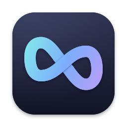

<p align="center">
  
</p>

<h1 align="center">Rydool</h1>

<p align="center">
  Clipboard history, screenshots, annotation, and screen recording — all from your Mac's menu bar.
</p>

<p align="center">
  <a href="https://github.com/ryderdinh/rydool/releases/latest"></a>
  <a href="https://github.com/ryderdinh/rydool/actions/workflows/ci.yml"></a>
  
  
  <a href="LICENSE"></a>
</p>

<p align="center">
  <a href="https://github.com/ryderdinh/rydool/releases/latest"><b>Download</b></a> ·
  <a href="#features">Features</a> ·
  <a href="#keyboard-shortcuts">Shortcuts</a> ·
  <a href="#permissions">Permissions</a> ·
  <a href="CHANGELOG.md">Changelog</a>
</p>

<!-- Hero image: uncomment once docs/images/hero.png (or demo.gif) is added.
<p align="center">
  
</p>
-->

## Features

- **Clipboard history** — Search everything you copy (text and images), pin favorites, and paste back into any app with the keyboard.
- **Screenshots** — Capture a region or a full display, even across multiple monitors. Every capture is copied to the clipboard instantly.
- **Annotation editor** — Add arrows, shapes, text, and freehand strokes, then zoom, copy, or save as PNG.
- **Screen recording** — Record a display or an area to MP4 at up to 60 FPS, with optional system audio and microphone.
- **Lightweight and private** — Lives in the menu bar, stores data only on your Mac, with no account and no cloud sync.
- **Localized** — English, Vietnamese, and Simplified Chinese.

<!-- Feature screenshots: uncomment once the images are added to docs/images/.
<table>
  <tr>
    <td align="center"><br><sub>Clipboard history</sub></td>
    <td align="center"><br><sub>Annotation editor</sub></td>
  </tr>
  <tr>
    <td align="center"><br><sub>Screen recording</sub></td>
    <td align="center"><br><sub>Settings</sub></td>
  </tr>
</table>
-->

## Installation

1. Download **`Rydool-macos.dmg`** from the [latest release](https://github.com/ryderdinh/rydool/releases/latest).
2. Open the DMG and drag **Rydool** to **Applications**.
3. Launch Rydool. It appears in the menu bar and opens **Settings → Permissions** on first launch.

Requires **macOS 14 Sonoma or later**, on Apple Silicon or Intel.

> [!NOTE]
> Rydool is signed ad hoc and is not notarized by Apple. If macOS blocks the first launch, open **System Settings → Privacy & Security**, click **Open Anyway** next to Rydool, and confirm.

## Keyboard shortcuts

| Action | Default shortcut |
| --- | --- |
| Open clipboard history | `⌥` `⇧` `V` |
| Capture a region | `⌘` `⇧` `4` |
| Capture the display under the pointer | `⌘` `⇧` `3` |
| Start / stop screen recording | `⌃` `⌥` `⇧` `R` |

Shortcuts can be changed in **Settings → Shortcuts**. If a shortcut is already used by another app, Rydool lets you pick a different one; the menu bar actions always work.

**In the editor:** `Enter` copies the image, `Shift`+`Enter` inserts a new line in text, and `Esc` cancels editing.

## Permissions

Rydool asks only for what each feature needs. You can review all permissions in **Settings → Permissions**.

| Permission | Used for | Required? |
| --- | --- | --- |
| Screen Recording | Screenshots and screen recording | For capture |
| Accessibility | Pasting automatically from history, and taking over the macOS screenshot shortcuts | Optional — without it, items are copied and you paste with `⌘V` |
| Microphone | Recording your voice | Only when the microphone is enabled |

## Usage

### Clipboard history

History is on by default and records anything copied after Rydool starts. Press `⌥⇧V`, type to search, and click an item (or use the arrow keys and `Enter`) to paste it into the app you were using. Pin items you use often; **Clear All** removes pinned items too. You can pause history from the menu at any time, and exclude apps under **Settings → Clipboard**.

### Screenshots and annotation

After a capture, a preview appears in the lower-right corner for five seconds (it stays while you hover over it). Click it to open the editor, or hover to copy, save, or dismiss it. Hidden previews can be reopened from **Recent Screenshots** in the menu until you quit; they are kept only in memory.

When a region spans displays with different pixel densities, Rydool uses the highest one for the combined image.

### Screen recording

Choose **Record Screen** from the menu or press `⌃⌥⇧R`. Pick a display and the full screen or an area, then choose resolution (original, 1080p, 720p), 30 or 60 FPS, quality, and audio sources. System audio is on by default; the microphone is off. A red indicator in the menu bar shows that recording is active. When you stop, choose where to save the MP4 — if you cancel, use **Save recording…** in the menu later.

## Privacy

Rydool has no account, no telemetry, and no cloud sync. Clipboard history is stored locally in SQLite at `~/Library/Application Support/Rydool/`.

Please keep in mind:

- History is **not encrypted** by Rydool and may be included in your backups.
- Rydool skips common password markers and the apps you exclude, but **this cannot catch every password**. Pause history when copying sensitive content.
- The source app is inferred from the frontmost window and may be wrong.
- Deleting an item does not guarantee secure erasure from SSDs or backups.
- Only plain text and images are stored — not rich text or files.

## Troubleshooting

<details>
<summary><b>A permission is granted, but Rydool still can't use it</b></summary>

Ad hoc builds are identified per build, so macOS may keep an old entry after you update or reinstall. Open **Settings → Permissions**, choose **Reset permission**, and allow Rydool again. Quit and reopen Rydool if macOS asks you to.
</details>

<details>
<summary><b>Pressing ⌘⇧4 opens both Rydool and the macOS screenshot tool</b></summary>

Grant Rydool **Accessibility** access so it can handle the shortcut before macOS does, or choose different shortcuts in **Settings → Shortcuts**.
</details>

<details>
<summary><b>A quick copy was not saved to history</b></summary>

Rydool checks the clipboard periodically, so copies made in very quick succession can be missed. If too many items arrive at once, Rydool skips new ones and notifies you.
</details>

## Building from source

Requires macOS 14 or later and Xcode 16.2 (or the matching Command Line Tools).

```sh
git clone https://github.com/ryderdinh/rydool.git
cd rydool
swift test
Scripts/build-app.sh debug
open build/Rydool.app
```

See [CONTRIBUTING.md](CONTRIBUTING.md) for release builds, code signing, and UI tests.

## Contributing

Bug reports, feature requests, and pull requests are welcome. Please [open an issue](https://github.com/ryderdinh/rydool/issues) first for larger changes, and read [CONTRIBUTING.md](CONTRIBUTING.md) before submitting a pull request.

## License

Copyright © 2026 ryderdinh. Rydool is released under the [MIT License](LICENSE).
